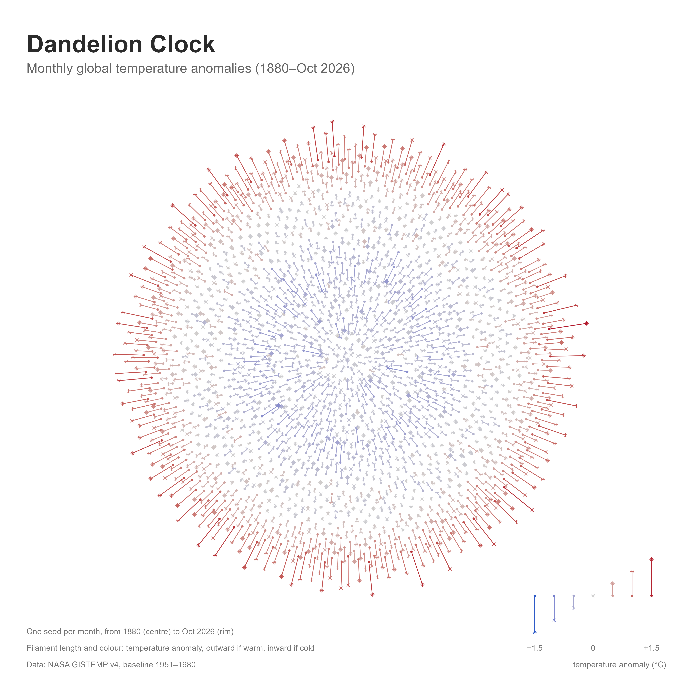

```{r setup, include=FALSE}
knitr::opts_chunk$set(cache = TRUE, echo = TRUE, message = FALSE, warning = FALSE, fig.align = 'center')
```

This is the creative challenge of the lab *Global warming through data*: design an original piece of climate data art using `ggplot2` and the NASA GISTEMP dataset. The artwork must be generated programmatically from the dataset, at least one visual property must encode a numerical variable, and the visual composition must communicate a meaningful aspect of global warming.

The artwork is called **Dandelion Clock**.

## The idea

In English the seed head of a dandelion is called a *clock*: children blow on it and count how many breaths are needed to blow all the seeds away, and that number is the time. In the demo *Draw flowers using R* a dandelion is drawn with the Golden Angle, with the remark that it is not possible to blow on it. In this artwork the data blow on it.

Each seed of the dandelion is a month of the temperature record, from 1880 in the centre of the flower to today at the rim. Each seed has a filament that is as long as the temperature anomaly of its month: it points outward when the month is warmer than normal, as if the seed were leaving the flower, and inward when the month is colder. The aspect of global warming that I want to communicate is that we are running out of time: the clock is being blown away, starting from the most recent months.

## The dataset

I use the NASA GISS Surface Temperature Analysis (GISTEMP v4), which provides the monthly global surface temperature anomalies from 1880 to the present. An anomaly is the difference, in degrees Celsius, between an observed temperature and the corresponding average temperature during the reference period 1951–1980. I import the data and I tidy them as in the lab, in order to have one month per row:

```{r}
library(tidyverse)

url <- paste0(
  "https://data.giss.nasa.gov/gistemp/",
  "tabledata_v4/GLB.Ts+dSST.csv"
)

temp_raw <- read_csv(
  url,
  skip = 1,
  na = c("***", "****"),
  show_col_types = FALSE
)

temp <- temp_raw |>
  select(Year, Jan:Dec) |>
  pivot_longer(
    cols = Jan:Dec,
    names_to = "month",
    values_to = "anomaly"
  ) |>
  mutate(month = factor(month, levels = month.abb)) |>
  drop_na(anomaly) |>
  mutate(t = row_number())   # month counter: 1 is January 1880

temp

# last observed month
last_label <- paste(last(temp$month), last(temp$Year))
last_label
```

The counter `t` of the months is the only time variable that I need. The dataset contains `r nrow(temp)` months, from Jan `r min(temp$Year)` to `r last_label`.

## How the artwork is generated

### One seed per month

As in the demo, the seeds are arranged with the Golden Angle: the seed of month `t` is placed at angle `t * angle`. The distance of the seed from the centre is the square root of `t`. In this way the seeds are uniformly spread on the head of the flower, hence every month takes the same area, no matter if it is an old month (near the centre) or a recent one (near the rim). In the demo the distance was `t`, and the outer points were more and more sparse.

```{r, fig.width=4, fig.height=4}
# the Golden Angle
angle <- pi * (3 - sqrt(5))

seeds <- temp |>
  mutate(
    theta = t * angle,
    r = sqrt(t),
    x = r * cos(theta),
    y = r * sin(theta)
  )

ggplot(seeds, aes(x, y)) +
  geom_point(size = 0.3) +
  coord_fixed() +
  theme_void()
```

### One filament per seed

The filament of a seed starts from the seed and goes along the radius of the flower. Its length is the anomaly of the month multiplied by `len`, which is the length of the filament for an anomaly of 1 °C. If the anomaly is positive the filament points outward, if it is negative it points inward, and a month exactly at the 1951–1980 mean has no filament.

```{r}
# length of the filament for an anomaly of 1 °C
len <- 5

seeds <- seeds |>
  mutate(
    xend = (r + len * anomaly) * cos(theta),
    yend = (r + len * anomaly) * sin(theta)
  )
```

### The colour

The colour of a seed is again the anomaly of its month. I use a diverging scale centred in zero as in the lab (`scale_colour_gradient2()` with `midpoint = 0`). The limits of the scale are symmetric, from `-m` to `m`, where `m` is the largest absolute anomaly in the data. In this way a cold month and a warm month with anomalies of the same size get equally strong colours. For the same reason I chose a blue and a red with the same lightness and the same saturation. Zero is a light grey, which remains visible on the white background.

```{r}
m <- max(abs(temp$anomaly))
m
```

### The legend

Instead of the usual colour bar, the legend is made of seven more seeds, with anomalies from −1.5 to +1.5 °C, which are drawn exactly like the seeds of the flower. Hence the legend explains at the same time the length and the colour of the filaments. It shows the whole symmetric scale, including the cold part that the data never reach.

```{r}
# seven seeds for the legend, in the bottom right corner
key <- tibble(anomaly = seq(-1.5, 1.5, by = 0.5)) |>
  mutate(
    x = 34.5 + 4 * row_number(),
    y = -48.5,
    xend = x,
    yend = y + len * anomaly
  )

key_labels <- key |>
  filter(anomaly %in% c(-1.5, 0, 1.5)) |>
  mutate(label = c("−1.5", "0", "+1.5"))

# the notes in the bottom left corner
notes <- tibble(
  y = c(-55.8, -59.2, -62.6),
  label = c(
    paste0("One seed per month, from ", min(temp$Year), " (centre) to ", last_label, " (rim)"),
    "Filament length and colour: temperature anomaly, outward if warm, inward if cold",
    "Data: NASA GISTEMP v4, baseline 1951–1980"
  )
)
```

### The artwork

Finally I draw the dandelion. Each seed is a small point, its filament is a segment and the pappus at the end of the filament is an asterisk (shape number 8, as in the dandelion of the demo). The seeds of the legend are bound to the seeds of the flower, so that they are drawn by the same code. The artwork has a title and a subtitle, a white background and a square format.

```{r}
dandelion <- ggplot(bind_rows(seeds, key)) +
  # the filament, the seed and its pappus
  geom_segment(aes(x = x, y = y, xend = xend, yend = yend, color = anomaly), linewidth = 0.28) +
  geom_point(aes(x, y, color = anomaly), size = 0.25) +
  geom_point(aes(xend, yend, color = anomaly), shape = 8, size = 0.95, stroke = 0.25) +
  # the texts of the legend and the notes
  geom_text(data = key_labels, aes(x, y = -59.2, label = label), size = 2.35, color = "grey45") +
  annotate("text", x = 65.5, y = -62.6, label = "temperature anomaly (°C)",
           hjust = 1, size = 2.35, color = "grey45") +
  geom_text(data = notes, aes(x = -66, y = y, label = label), hjust = 0, size = 2.35, color = "grey45") +
  scale_colour_gradient2(
    low = "#1E57C8",
    mid = "#D0D0D0",
    high = "#B2182B",
    midpoint = 0,
    limits = c(-m, m),
    guide = "none"
  ) +
  coord_equal(xlim = c(-66, 66), ylim = c(-68.5, 56), expand = FALSE) +
  labs(
    title = "Dandelion Clock",
    subtitle = paste0("Monthly global temperature anomalies (", min(temp$Year), "–", last_label, ")")
  ) +
  theme_void() +
  theme(
    plot.background = element_rect(fill = "white", color = NA),
    plot.title = element_text(face = "bold", size = 20, color = "#2B2B2B"),
    plot.subtitle = element_text(size = 11, color = "grey40", margin = margin(t = 5, b = 10)),
    plot.title.position = "plot",
    plot.margin = margin(22, 22, 0, 22)
  )
```

I save the artwork in a local PNG file, with a square format, and I show it:

```{r}
ggsave("dandelion-clock.png", dandelion, width = 8, height = 8, dpi = 600)
```

```{r, echo=FALSE, out.width='100%'}

```

## How to read the artwork

The data are mapped to the artwork in the following way:

* each **seed** is a month of the dataset;
* the **position** of a seed encodes time: the seeds follow the Golden Angle from the first month (centre of the flower) to the last month (rim), and the distance from the centre is the square root of the month counter;
* the **length** of the filament of a seed encodes the temperature anomaly of the month (`len` units for each °C), and its **direction** encodes the sign: outward if the month is warmer than the 1951–1980 mean, inward if it is colder;
* the **colour** of a seed encodes again the anomaly, from blue (cold) to grey (zero) to red (warm);
* the title and the notes carry no data.

```{r}
# coldest and warmest month
temp |> slice_min(anomaly, n = 1)
temp |> slice_max(anomaly, n = 1)

# last month colder than the 1951-1980 mean
last_cool <- temp |>
  filter(anomaly < 0) |>
  slice_tail(n = 1)

last_cool
```

In the centre of the flower, which contains the first decades, almost all the filaments are blue and point inward. Then there is a calm grey ring: these are the years around the reference period 1951–1980, where the anomalies are close to zero by construction. After that the filaments turn red and point outward, longer and longer: the last month colder than the mean is `r paste(last_cool$month, last_cool$Year)`. At the rim the seeds are leaving the flower.

The two sides are not symmetric: the coldest month is `r abs(min(temp$anomaly))` °C below the mean, while the warmest month is `r max(temp$anomaly)` °C above it. For this reason the blue filaments are short and pale and the red ones are long and dark, even if the scale treats cold and warm in the same way.

## Design choices

I tried to avoid any bias in the artwork:

* all the months of the dataset are drawn, from the first to the last one, without selecting a period;
* every month has the same room: all the seeds have the same size and, thanks to the square root, they take the same area of the flower. In the Climate Spiral of the lab each year takes one turn, hence the recent years are drawn with longer lines than the old ones;
* the length of a filament is proportional to the anomaly and it starts from zero;
* the colour scale is symmetric around zero, and the legend shows the whole scale;
* the data are used as they are: they are not smoothed and the reference period of NASA is not changed.

The value of `len` is arbitrary: I chose it so that the longest filaments are clearly visible without hiding the neighbouring seeds, and it is the same for all the months and for the legend.

On the other hand, some information is lost with respect to a conventional chart: in the artwork it is not possible to read the exact value or the exact date of a month.
